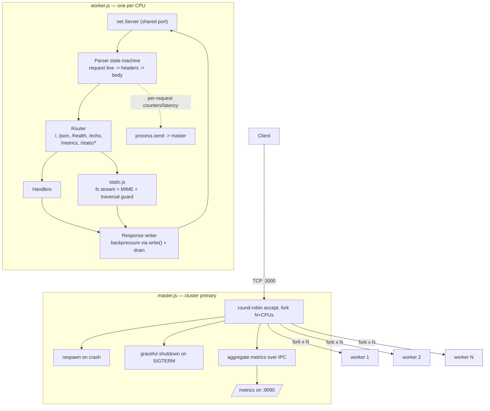

# Raw HTTP Server

An HTTP/1.1 server implemented **from scratch on raw TCP sockets** in Node.js — no
web framework, no `node:http` on the data plane. It includes a hand-written,
incrementally-fed request parser, keep-alive and pipelining, backpressure-aware
response writing, streamed static files with a path-traversal guard, multi-core
clustering with worker respawn, Prometheus metrics, and a benchmark harness that
compares it against Node's built-in `http` module.

## Architecture



## Key design decisions

- **Cursor-based parser.** `Parser.feed()` appends chunks to one growing buffer
  and advances an offset pointer rather than repeatedly slicing — parsing stays
  linear. It compacts the buffer periodically to keep memory bounded across
  thousands of keep-alive requests. Every split point (including one byte at a
  time) is covered by unit tests.
- **Ordered pipelining.** Each connection chains response writes onto a promise
  queue so pipelined requests are answered in order, even though handlers are
  async.
- **Backpressure.** `writeResponse` resolves only once the socket has drained;
  static files are piped through `fs.createReadStream` with `pause()`/`resume()`
  on `drain`.
- **`setNoDelay(true)`.** Disabling Nagle's algorithm avoids the Nagle +
  delayed-ACK interaction between the separately-written response head and body,
  cutting static-file latency from ~41 ms to ~1 ms (a 50× throughput gain).
- **Slowloris / memory safety.** Header read timeout, idle keep-alive timeout,
  caps on buffer/header/body/request-line sizes, a max header count and a max
  request count per connection. `Connection: close`, oversized bodies and
  chunked request bodies are handled explicitly (`413` / `431` / `501`).
- **Multi-core.** The primary forks `os.availableParallelism()` workers that
  share port 3000 via cluster's round-robin accept, respawns any that die, and
  aggregates counters + latency histograms from each worker over IPC onto an
  admin `:9090/metrics` endpoint.

## Quick start

```bash
npm install
npm start                 # multi-core cluster on :3000, admin metrics on :9090
curl http://localhost:3000/
curl http://localhost:3000/json
curl http://localhost:3000/health
curl http://localhost:3000/static/index.html
curl http://localhost:9090/metrics
```

Docker (one command, multi-core by default):

```bash
docker compose up --build
docker compose --profile bench up baseline   # optional comparison server
```

## Scripts

| Script | Description |
| --- | --- |
| `npm start` | Start the clustered server (primary + N workers). |
| `npm run start:worker` | Start a single worker directly (no cluster). |
| `npm test` | Run unit + integration tests with the built-in test runner (33 tests). |
| `npm run lint` | Dependency-free syntax check of all JS files. |
| `npm run bench` | Run the autocannon benchmark harness (writes `results/benchmark.md`). |

## Configuration

All settings have defaults and can be overridden via environment variables
(`src/config.js`): `HOST`, `PORT`, `WORKERS`, `ADMIN_HOST`, `ADMIN_PORT`,
`MAX_BUFFER_SIZE`, `MAX_HEADER_SIZE`, `MAX_HEADER_COUNT`, `MAX_BODY_SIZE`,
`MAX_REQUEST_LINE`, `MAX_REQUESTS_PER_CONNECTION`, `HEADER_TIMEOUT`,
`KEEP_ALIVE_TIMEOUT`, `SHUTDOWN_TIMEOUT`, `STATIC_DIR`, `METRICS_INTERVAL`.

## Routes

| Route | Description |
| --- | --- |
| `GET /` | HTML landing page |
| `GET /json` | JSON payload |
| `GET /health` | Liveness probe (`{"status":"ok"}`) |
| `GET,POST,… /echo` | Echoes method, query, headers and body |
| `GET /metrics` | This worker's Prometheus metrics |
| `GET /static/*` | Streamed static file from `public/` (traversal-protected) |

Wrong methods return `405` with an `Allow` header; unknown routes return `404`.

## Benchmark results

Measured with autocannon on an AMD Ryzen 5 5600H (12 logical cores), Node v24.19.0.
Both servers ran **single-process** for an apples-to-apples comparison and both
streamed static files from disk. 3 s/run, 1 s warm-up. Full data in
[`results/benchmark.md`](results/benchmark.md).

| Metric | From-scratch server | Built-in `http` (baseline) |
| --- | --- | --- |
| Peak throughput (`/json`) | **38,725 req/s** | 30,936 req/s |
| Peak throughput (`/static`, disk) | 13,561 req/s | **16,716 req/s** |
| Avg latency (`/json`, 100 conn) | 2.47 ms | 3.02 ms |
| p99 latency (`/json`, 100 conn) | 5 ms | 5 ms |
| Error rate | 0% | 0% |
| Concurrent connections sustained | 200+ | 200+ |

The from-scratch server leads on in-memory JSON throughput (the hand-written
parser and single-buffer response path avoid the `node:http` allocation overhead),
while `node:http` is somewhat faster on disk I/O because its stream plumbing is
more mature. Both held 0 errors at every concurrency level. Reproduce with:

```bash
npm install
DURATION_MS=15000 WARMUP_MS=3000 REPS=3 \
  CONNECTIONS=10,50,100,200,500 npm run bench
```

## Test coverage

- **Parser (21 tests):** basic parsing, query splitting, duplicate headers,
  bodies, empty bodies, `Connection: close`, HTTP/1.0, byte-by-byte and every
  fixed chunk size, pipelining, split leftovers, and all error paths
  (malformed line, bad version, invalid/duplicate `Content-Length`, chunked
  `501`, and `413`/`431` limits).
- **Integration (11 tests):** a real spawned worker driven by a raw TCP client —
  `/`, `/json`, `/health`, streamed `/static`, traversal rejection, `POST /echo`,
  pipelining, `400`, `405`, `HEAD`, and `/metrics`.

## Tradeoffs / explicitly out of scope

Implemented subset is deliberate. Not supported (treated as maturity signals,
not oversights): chunked **request** bodies (`501`), HTTPS/TLS, HTTP/2,
compression, range requests, conditional caching/`ETag`, and rate limiting.
The admin `/metrics` port uses `node:http` intentionally — it is control-plane
only, not part of the benchmarked data path.

## Résumé bullet

> **High-Performance HTTP Server | Node.js, Raw TCP, Cluster**
> - Built an HTTP/1.1 server from scratch on raw TCP sockets, implementing a
>   state-machine request parser, keep-alive, pipelining and backpressure handling
>   without a framework.
> - Scaled across all CPU cores with Node's `cluster` module, including worker
>   respawn, IPC metrics aggregation and graceful shutdown.
> - Benchmarked with autocannon: **38,725 req/s** peak on `/json`, **p99 5 ms**,
>   **0% error rate** at **100+** concurrent connections, with built-in `http`
>   as a baseline.

## License

MIT
